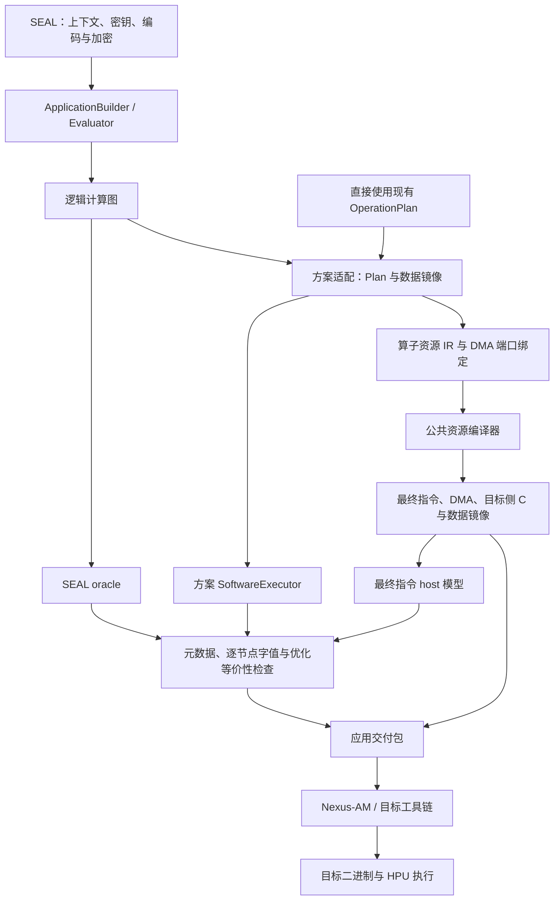

# HPU 项目架构

本文说明当前代码从应用接口到 HPU 交付包的完整流程，覆盖 CKKS、BFV、BGV，
并包含原《编译器资源管理》的资源 IR、DDR 复用、对象调度和验证说明。

## 1. 项目定位与阅读入口

当前项目是基于 C++ 嵌入式接口的 FHE/HPU 专用图编译器，同时提供 SEAL 适配、
host 软件验证和应用交付工具。程序员使用 SEAL 风格接口构建计算图，编译器将其
降低为 HPU 指令，并生成执行所需的数据镜像、DMA 清单和目标侧 C 调用入口。

| 读者任务 | 入口 |
| --- | --- |
| 编写应用或测试用例 | [Evaluator 前端入门](../getting-started/HPU_EVALUATOR_FRONTEND.md)，然后阅读对应方案的前端示例 |
| 理解分层、编译过程和 runtime | 本文第 2～5、7 节 |
| 新增算子或优化内存、对象调度 | 本文第 6 节及 [HPU 编程手册](../reference/HPU_PROGRAMMING_MANUAL.md) |
| 对接 Nexus-AM、执行与读回 | 本文第 9 节及 [应用包 V1](../delivery/HPU_APPLICATION_PACKAGE_V1.md)、[IT 交接清单](../delivery/IT_HANDOFF_CHECKLIST.md) |
| 维护 SEAL 数据与方案语义适配 | [SEAL 集成设计](HPU_SEAL_INTEGRATION.md)及 [底层 API 参考](../reference/HPU_LOW_LEVEL_API_REFERENCE.md) |

## 2. 整体流程



整个流程分为两个阶段：

1. **host 构图、编译与交付**：运行应用生成程序，记录计算图、准备数据、
   分配资源、生成指令，并完成软件对拍。
2. **目标端编译与执行**：IT 使用 Nexus-AM/目标工具链编译生成的 C，配置
   HPU_MEM、加载初始镜像、执行程序，再读回结果与 golden 比较。

前端的 `compile()` 完成第一阶段的编译与验证，`write()` 将结果写入交付目录。
目标端执行证据由 IT 单独提供。

## 3. 代码分层与职责

| 层次 | 主要代码位置 | 职责 |
| --- | --- | --- |
| 应用前端 | `hpu/seal/evaluator.hpp`、`src/hpu/seal/evaluator.cpp` | 导入输入、记录逻辑值与依赖、校验元数据、标记输出和发起编译 |
| SEAL 与方案适配 | `include/hpu/seal/`、`src/hpu/seal/` | 处理上下文和 level，将 SEAL 对象转换为 HPU 数据布局，构建 Plan、常量、密钥、twiddle 与工作区 |
| 方案算子 | `include/scheme/`、`src/scheme/` | 实现 CKKS/BFV/BGV 的算子组合、域转换与方案专有后处理 |
| 公共算法组件 | `operator/`、`poly/`、`util/` 对应的 include/src | 组合 KeySwitch、CMult、ModUp/ModDown、NTT 和逐点运算，发出资源操作 |
| 资源 IR 与编译后端 | `hpu/compiler/operator_resources.hpp`、`resource_ir.hpp` 及对应 cpp | 建立虚拟对象与缓冲区，分析生命周期，分配对象槽位、bank 和 DDR，生成最终资源操作 |
| 公共交付编译与包格式 | `include/hpu/delivery/`、`src/hpu/delivery/` | 连接资源编译、重定位、最终指令验证与 C 生成，写出和校验通用应用包 |
| 指令编码与目标侧 C 生成 | `encode/` | 定义、解析和编码 ISA，生成 32 位指令及带 DMA 参数的 C wrapper |
| 内存与生命周期基础设施 | `include/hpu/runtime/`、`src/hpu/runtime/` | 提供 HPU_MEM 镜像、对象状态约束及基础模运算功能模型 |
| 软件验证模型 | `hpu/seal/*software_executor*`、`hpu/model/` | 分别执行方案级算法与最终指令字，检查它们与独立 SEAL oracle 的一致性 |

三方案共用前端句柄、资源编译器和交付协议。各方案的数据准备和数学实现保留各自
规则，例如 CKKS 的 scale/rescale、BGV 的 correction factor 和 BFV 的乘法基转换。
具体支持范围以 [前端入门的支持表](../getting-started/HPU_EVALUATOR_FRONTEND.md#3-当前支持范围) 为准。

## 4. 程序员使用的顶层 API

### 4.1 接口与最小程序

新应用使用 `hpu/seal/evaluator.hpp`：

| 接口 | 主要方法与用途 |
| --- | --- |
| `ApplicationBuilder` | `import_ciphertext`、`import_plaintext` 导入输入；`evaluator` 获取操作接口；`mark_output` 命名输出；`compile` 编译 |
| `Ciphertext`、`Plaintext` | 表示图中的逻辑值，提供 `parms_id`、scale 等元数据查询 |
| `Evaluator` | `add/sub/multiply/square`、明文运算、重线性化、方案适用的旋转与降层操作及 `_inplace` 变体 |
| `CompiledApplication` | `write` 导出包；`verified`、`instruction_verified` 查询软件验证结果；`resource_report_json` 查看资源统计 |

下面假定已有有效的 `context` 和 SEAL `encrypted_input`，构建三方案均支持的加法应用：

```cpp
#include "hpu/seal/evaluator.hpp"

hpu::seal_adapter::ApplicationBuilder app(context);
auto evaluator = app.evaluator();
const auto x = app.import_ciphertext("input/x", encrypted_input);

hpu::seal_adapter::Ciphertext y;
evaluator.add(x, x, y);
app.mark_output("y", y);

const auto compiled = app.compile("my_add");
compiled.write("outputs/my_add"); // 直接写包要求目标目录不存在。
```

context、编码、加密、密钥生成和解密继续使用 native SEAL。应用向操作接口传入所需
评估密钥，前端自动准备对应的 HPU 密钥布局、常量、twiddle 和工作区。

完整程序与构建命令见 [Evaluator 前端入门](../getting-started/HPU_EVALUATOR_FRONTEND.md)，
示例为 [CKKS](../../examples/ckks_evaluator_application.cpp)、
[BFV](../../examples/bfv_evaluator_application.cpp)、
[BGV](../../examples/bgv_evaluator_application.cpp)。

### 4.2 构图与值语义

`Evaluator` 的方法记录计算图，host 执行、对拍和编译发生在 `compile()`。
调用顺序给出图的构造顺序，输入句柄给出数据依赖；同一输入可被多个节点引用，
因此能构造分支与汇合。当前后端按依赖生成静态指令序列。

句柄表示不可变逻辑值。复制句柄保留原值，`_inplace` 创建新值并重新绑定传入的
句柄，其他引用仍指向旧值。输入与评估密钥按快照捕获；后续修改原 SEAL 对象或
继续构图，不会改变已经编译的包。

前端保留 SEAL 风格的显式操作：`multiply` 后的重线性化、rescale、mod switch
和 scale 调整均由应用选择。`set_scale` 是共享数据的元数据视图，不发出算术指令。

多个结果可以通过 `mark_output` 命名。目前每个计算节点的结果也保留用于 IT 读回。
`compiled.oracle_result(value)` 返回 SEAL 参考结果；实际 HPU 结果由目标端另行读回。

## 5. 从计算图到最终指令

`ApplicationBuilder::compile()` 位于 `src/hpu/seal/evaluator.cpp`，主要过程为：

1. 冻结图、输入和密钥快照，按图运行独立 SEAL oracle。
2. 根据 context 的 scheme 创建对应 Plan 和应用镜像，准备资源与输出元数据。
3. 用对应方案的 SoftwareExecutor 执行应用，与 oracle 比较各节点的元数据和字值。
4. 展开方案算子，收集原生 `OperatorProgram`，并准备与镜像关联的 DMA 端口。
5. 公共交付编译器将算子资源 IR 绑定为 `VirtualProgram`，完成资源优化、DMA 和
   golden 目的地址重定位，重新生成最终指令与目标侧 C。
6. host 指令模型执行最终指令字与实际 DMA span，与 oracle golden 比较。
   优化模式还比较原始流与优化流的全部保留输出。
7. 返回持有编译快照、包请求和报告的 `CompiledApplication`。

公共交付编译入口为 `hpu/delivery/resource_compiler.hpp` 中的
`compile_application_resources()`；`src/hpu/seal/frontend_package.cpp` 将前端连接
到该公共入口。

现有 `CkksOperationPlan`、`BfvOperationPlan`、`BgvOperationPlan` 仍可直接使用。
它们创建的应用包携带原生资源程序，`write_application_package()` 在私有镜像上
完成相同的优化、重定位和严格指令对拍。调用者的 Image/Plan 保持原布局，已经编译
的前端包直接导出。只含原始编码指令的历史请求继续使用兼容导出路径。

旧 Plan 示例打印的 `--print-asm` 和指令计数属于兼容基准；最终交付指令及地址
以包中的 `program/*.asm`、`*.inst32` 和 `dma_relocation_manifest.csv` 为准。

## 6. 编译器资源管理

### 6.1 算子资源 IR

公共资源编译器位于 `hpu/compiler/resource_ir.hpp/.cpp`，算子资源接口位于
`hpu/compiler/operator_resources.hpp/.cpp`。CKKS、BFV、BGV 共用对象调度、
DDR 生命周期复用和交付编译后端。

算子通过 `make_operand(label, compatibility_slot=-1)` 创建独立变量，同名变量也具有
不同身份。`Recording` 对每次加载、算术结果和 NTT stage 定义分配新的 `ValueId`，
`Operation.inputs/outputs` 直接引用 SSA 版本。`value`、`auxiliary` 等旧别名仅供兼容
入口使用，原生算子已使用独立变量。变量数量不受物理对象槽位数量限制。

```cpp
namespace r = hpu::resource;
r::Recording recording;
const auto a = r::make_operand("input");
const auto b = r::make_operand("input"); // 与 a 是两个独立变量。
const auto product = r::make_operand("product");
r::read(a, hpu::DataType::poly);
r::read(b, hpu::DataType::poly);
r::multiply(product, a, b);
r::accumulate(product, a, b); // 产生新的 SSA 版本，输入包含旧 product。
r::publish(product);
auto program = recording.finish();
```

`read/publish` 直接建立显式 `PortId`，每个端口记录所属操作、方向和独立 binding。
调用方用 `bind_port()` 或 `bind_ports()` 提供 allocation/span；
`bind_program(program, image)` 从这些端口检查范围、只读属性和 SSA 定义使用关系，
构建后端 `VirtualProgram`。未绑定端口、重复定义和未定义输入在此阶段报错。

`Recording` 在线程间隔离，嵌套作用域和异常展开恢复外层记录器。程序片段通过
`append()` 重新编号局部 SSA 值与端口，显式连接片段的活跃输入；CKKS/BFV 保存
每个操作的原生片段，BGV 拼接独立子程序时同步处理这些身份。

SSA 降低时根据最后使用位置合并可安全复用的存储。NTT 的数据对象和 PMAC 的
累加器是强制原地输入；旧 SSA 值仍有后续使用时，编译器通过独立 snapshot
工作区和 DSTORE/DLOAD 初始化新版本，保留旧版本的精确 uint32 字值。
延迟写回与唯一重载关联时，存储生命周期至少保留到该重载，避免跨间隔被其他值覆盖。

现有 `generate_*_body_asm` 返回接口保留，操作数的可选槽位提示只供兼容汇编渲染。
CKKS/BFV 从原生片段的端口声明构造 DMA 绑定，兼容汇编用于一致性检查；历史手工
请求保留汇编导入路径。资源编译器的原生入口直接使用 SSA 与端口，不恢复汇编数据流。
`render_operator_ir(program)` 可输出 SSA 值与端口文本。各方案的数据准备 recipe
继续分别维护，前端 Evaluator API 和包 V1 协议保持兼容。

### 6.2 逻辑值、对象与缓冲区

| 概念 | 职责 |
| --- | --- |
| 前端逻辑值 | 数学依赖、level、分量数、scale、correction factor |
| 算子 `ValueId` / `PortId` | 单次定义的值版本 / 显式内存访问端口 |
| `VirtualObject` | SSA 降低后的片上存储对象及长度、加载类型；可承载不重叠的值版本 |
| `VirtualBuffer` | DDR 逻辑分配、读写属性、首次/最后使用和布局标签 |
| `VirtualInstruction` | 对象 uses/definitions、DDR range、原始指令及算子来源 |

一个逻辑密文含多个分量和 RNS limb，因此对应多个对象与缓冲区。算子的符号
操作数在定义时建立对象生命周期，调度器选择物理槽位；输入端口的 `BufferRange`
记录初始化来源。

内存布局与数学域分别处理。IR 提供 `coefficient_natural`、
`coefficient_bit_reversed`、`canonical_ntt_physical`、`unspecified` 标签。
资源后端的 `hpu::compiler::CompileOptions.buffer_layouts` 可按真实 allocation
名称显式标注，NoOpt 与优化模式均保留标签，不据此修改字值。

公共交付编译器根据适配器约定标注已知输入和评估密钥，并按 golden ABI 标注输出。
输出标签表示期望布局，结果仍由指令比较检查。一个 workspace 在执行中可能保存
系数、NTT 或 stage 中间数据，因此跨域 workspace 保持 `unspecified`。

### 6.3 DDR 工作区复用

为了提供逐节点读回，输入、常量、明文、评估密钥和每个计算节点结果都保留独立
存储。当前优化重点是算子内部 `workspace`，只有满足以下条件才可复用：

1. 可写且不属于需要保留的结果。
2. 所有初始读操作之前，相关 line 已由程序写入。
3. 生命周期与拟复用的区域没有交叠。

依赖初始零值的 workspace 保留独立存储。复用器按使用区间进行确定性、line
对齐的放置，建立统一 `$compiler/scratch_arena`。CKKS Plan 的 Relinearize/Rescale
默认声明独立系数工作区以保留输入节点的 NTT 数据，后端按生命周期复用这些工作区。

`memory/memory_manifest.csv` 描述实际物理分配；scratch arena 作为一个分配出现。
每个逻辑 workspace 的子范围记录在 `compiler_resources.logical_buffers` 中。
最终 DMA 指向对应物理 allocation 与子 span。spill 使用独立可写 backing，
保留输入、只读资源及 IT 所需的逐节点结果。

### 6.4 片上对象与 bank 调度

HPU 有 **64 个逻辑对象槽位 p0…p63**，与物理 bank 独立。Bank 0…4 各
1024 line；普通区间以 128 line 为单元，容量为
`128 * next_pow2(ceil(actual_len/128))`，起点按容量对齐。短对象可共享 bank，
N8192 最多静态容纳 40 个，但执行还须为新结果预留候选区间。

`runtime::BankAllocator` 维护每个逻辑对象的 bank、base、实际长度和保留容量，
由编译器与逐指令模型共同使用。默认 Bank 5 前 4 line 永久保留模表，
其余可容纳 14 个两条 line、TYPE=3 的只读 stage 参数。mask 仅约束 DLOAD。

普通算术有匹配长度目的时复用原区间；新目的按源读取次数最少的可用 bank 分配，
以 `dst%5` 起的循环次序打破并列。PMAC 与每个 NTT stage 总是先申请新结果，
完成后才回收旧区间；NTT 还必须排除输入 bank。失败保持旧映射。
完整规则见 [Bank 分配指南](../reference/HPU_BANK_ALLOCATION_GUIDE.md)。

调度器预先建立下一次使用索引，保护当前操作数，优先淘汰下一次使用最远的对象。
干净数据直接释放，脏数据保存到 backing；是否需要淘汰由实际候选区间与空闲对象号
共同决定，不能只比较对象个数或总剩余空间。固定的 128 个 NTT 运算寄存器由硬件
stage 调度使用，编译器不分配 PE 内部寄存器。

DSTORE REL=0 保留对象，REL=1 成功完成后释放；spill 需明确释放。
后端可消除有完整生命周期证明的内部 workspace 写回，必需节点输出仍写回。
最终代码使用 x10/x11 DMA sideband，并声明 `hpu-objects64-v1.1` ISA。

### 6.5 NoOpt 基准

`OptimizationMode::no_opt` 保留原始指令字、每条 DMA 的 offset/count、原始镜像
字节和分配，同时检查对象、DMA 与 bank 容量，并生成资源统计。

上述保留行为适用于提供兼容指令基线的现有前端。直接编写原生 SSA IR、没有提供
基线时，NoOpt 仍执行必要的槽位分配，但关闭 workspace 写回延迟和 DDR 复用。
若旧 SSA 值跨 NTT/PMAC 原地更新继续存活，必须生成保留旧值的 DMA 副本；
此时 NoOpt 也以 SSA 语义为准进行保守降级，不能直接返回无法表达该语义的旧指令。

前端通过 `hpu::seal_adapter::CompileOptions.optimize_resources=false` 选择该模式，
示例 CLI 使用 `--no-opt`。NoOpt 用于重现原始调度和比较优化结果；原始流与 oracle
的数学一致性仍由独立验证决定。

### 6.6 资源报告

报告写入 `oracle/report.json` → `compiler_resources`，前端也可通过
`compiled.resource_report_json()` 读取：

| 字段 | 内容 |
| --- | --- |
| `ir_source` | `operator` 表示算子直接发出的 IR；历史导入入口为 `encoded_import` |
| `original_ddr_lines` / `allocated_ddr_lines` | 原始与最终 DDR 使用量 |
| `scratch_arena_lines` | 复用工作区的物理容量 |
| `original_dma_count` / `dma_count` | 优化前后 DMA 次数 |
| `peak_regular_banks` / `peak_object_slots` | 调度峰值，计入 stage 额外 bank |
| `deferred_scratch_stores` | 可通过片上保留延迟的内部写回 |
| `spills` / `reloads` | 资源压力下的保存和重载次数 |
| `logical_buffers` | 逻辑名称、物理 allocation、原始与最终 span、生命周期和布局标签 |

能节省多少 DDR 和 DMA 取决于图及 workspace 生命周期；保留全部节点结果会限制
压缩空间。

## 7. runtime 的作用与边界

### 7.1 runtime 核心

`include/hpu/runtime/` 与 `src/hpu/runtime/` 提供执行所需的数据表示、内存模型和
生命周期约束：

| 模块 | 当前职责 |
| --- | --- |
| `HpuMemImage` | 构建确定性的 HPU 可见 DDR 镜像，管理 256B 行对齐的 allocation、span 和只读别名；提供初始数据与序列化来源 |
| `runtime::Application` | 记录与检查模表加载、对象驻留、脏状态、写回、释放和结束时的 `psync`；同时维护 domain、level 与 key domain |
| `HpuSoftwareExecutor` | 在 host 内存中执行读写、复制和精确 uint32 模运算，为方案软件执行器提供基础功能模型 |

`runtime::Application` 的 `run_kernel()` 记录事件与写入状态。该状态机目前主要由
适配辅助接口和测试使用；前端编译路径的自动资源分配由 `compiler` 后端完成。
状态机管理对象槽位生命周期，bank 容量由资源编译器和指令模型检查。

### 7.2 RuntimeProgram 与目标侧 C

`hpu/seal/operation_runtime.hpp`、`bfv_operation_runtime.hpp` 等接口将降低后的
程序组织为编码指令与有序 DMA span，生成目标侧 C/h。最终资源编译后，公共交付
编译器按最终布局重新渲染这些产物。

- `hpu_program_<stem>(spans, count)` 接收按 DMA 次序排列的动态 span。该入口保持
  原实现，运行时检查 span，并在每条 DMA 前分别设置 `x10` 和 `x11`。
- `hpu_run_<stem>()` 使用生成时已经解析好的固定 span。生成器先检查范围、bank
  容量和对象长度，再将整个 HPU 流放入一个连续的 `asm volatile` 块。每条 DMA
  前重新设置 `x10`；`x11` 只在首次 DMA 和长度变化时设置。
- `x10` 传 line offset，`x11` 传 line count，两者均以 HPU line 为单位。
  固定入口显式声明 `x10`、`x11` 和 `memory` clobber，连续汇编块中没有可覆盖
  `x11` 的 C 代码。HPU 指令字和执行次序保持不变。

这项优化发生在资源调度完成后的目标 C 生成阶段，使用最终的 DMA 次序及 span。
固定 span 表和应用包 V1 协议保持兼容；校验器也接受此前由固定入口调用动态入口
的 V1 源码。

host 逐指令模型直接使用 DMA span，不执行 CPU wrapper，因此不能验证目标代码
实际写入 `x10/x11` 的值。`hpu_target_dma_codegen_test` 将生成 C 编译为 RV32/RV64
目标代码，检查 CPU 执行时的 DMA 参数、HPU 指令顺序及 `x11` 设置次数。
工具链配置和执行命令见 [IT 交接清单](../delivery/IT_HANDOFF_CHECKLIST.md#31-目标-cpu-包装代码检查)。

目标平台需要由 Nexus-AM/IT 完成工具链编译、HPU_MEM 配置、初始镜像加载、启动
与结果读回。当前项目提供这一对接所需的程序和数据，设备驱动及平台运行环境由
目标集成负责。

### 7.3 软件执行模型

方案级 `CkksSoftwareExecutor`、`BfvSoftwareExecutor`、`BgvSoftwareExecutor` 按算子
算法执行同一镜像。`hpu/model/instruction_executor.hpp` 中的逐指令模型则解码最终
指令字，模拟 DMA、对象状态和算术操作。两者用于 host 验证，具体证据边界见下一节。

## 8. 验证路径与证据边界

### 8.1 三条计算路径

前端自动执行并比较：

```text
native SEAL 图执行
        ↕ 每个节点的元数据和字值
各方案 SoftwareExecutor
        ↕ 同一份 oracle golden
最终指令字 + 实际 DMA span 的 host 执行模型
```

SEAL oracle 独立使用导入输入和图操作计算。逐指令模型解码 `instruction.word`，
并从实际镜像读取 modulus、常量和 twiddle，独立于 companion `normalized_asm`
及语义对象字段。

| 状态或接口 | 含义 |
| --- | --- |
| `CompiledApplication::verified()` | SEAL 与方案 SoftwareExecutor 的元数据和字值比较通过 |
| `InstructionExecutionReport::completed()` | 指令与 span 执行完成 |
| `InstructionMemoryComparison::verified` / `CompiledApplication::instruction_verified()` | 最终指令模型的保留输出逐字匹配 oracle |
| `optimization_equivalence_verified` | 优化流与 NoOpt 的全部保留输出一致 |

执行完成不意味着与 oracle 一致。缺少 DMA、非法生命周期、只读区写入、bank
不足、未知 mode/flag 和数值不匹配分别给出诊断。优化等价检查验证调度与复用是否
改变原始流结果，SEAL 比较验证结果是否满足独立 oracle，两者分别记录。

严格编译默认要求三条计算路径通过。前端设置
`CompileOptions.require_instruction_verification=false` 可显式诊断导出，保留失败
记录；它仍要求 SEAL 与算子软件模型通过，并检查优化是否改变原始流结果。

用例作者还应提供独立数学预期，例如解密后与 `x²+1` 或旋转表达式比较，确认所构建
的图符合测试目标。私钥仅用于 host 解密，不进入交付包。

### 8.2 NTT 软件契约

`execute_ntt_stage` 执行供应表所指定的一个 raw loader/BF/P stage。逐指令层提供
两个功能软件契约：

| `InstructionNttContract` | 行为 |
| --- | --- |
| `natural_coefficient_boundaries` | 默认；PNTT stage 0 的 raw stage 前做数学边界 BR，最后一个 PINTT raw stage 后做数学边界 BR，完整变换以自然位置读写系数 |
| `legacy_raw_stage` | 保留旧 loader/BF/P stage，不增加整体边界转换；正向入口使用 BR 系数 |

两个契约都逐位置执行 PMUL，原样消费 DMA 和表。默认契约中的 BR 为软件数学
边界转换，不额外编码 BR 指令。三方案 builder 与 SoftwareExecutor 使用相同的
自然系数 pre/post 索引，twist、untwist 和归一化由显式 PMUL 完成。

当前 stage DMA 使用固定 512 B 的 K=8 在线生成参数。镜像构建时，公共
`pack_stage_twiddles` 从完整物理 oracle 表提取 U/V/R 并重构全表校验；逐指令层和
算子 SoftwareExecutor 从实际 DMA 参数调用 `expand_stage_twiddles`，再交给原
raw stage 数学模型。完整表 API 保留为离线 oracle，不再作为生产 src2 payload。
前端 API 与 pre/post 数学边界保持不变；当前使用六位对象编码，参数默认 TYPE3
放入 Bank 5，普通 bank 按 128-line 单元分配。K=8 参数内容继承先前迁移，
最新 ISA 与放置规则见 [编程手册](../reference/HPU_PROGRAMMING_MANUAL.md)。

完整公式、stage 表顺序及 raw inverse API 适配见
[编程手册的变换契约](../reference/HPU_PROGRAMMING_MANUAL.md#9-本项目的接入约定)，
数据 ABI 与旧包迁移见
[应用包 V1](../delivery/HPU_APPLICATION_PACKAGE_V1.md#新应用镜像的-ntt-表与软件边界)。
选择回放契约不修改镜像、DMA 或指令，新自然镜像使用 legacy profile 可能比较失败。

完整往返正确不能单独证明正向谱正确；验证应包含独立求值或 SEAL oracle，检查
canonical 与 modified-root 路径。实际测试规模和结果以测试日志、各包报告为准。
独立反例、CKKS 舍入修复和验收快照见
[2026-10 审计](../audits/HPU_NTT_CONTRACT_AUDIT_2026-10.md)。

### 8.3 目标验证

host 模型描述功能行为，尚未建立 RTL 每 stage 地址和周期的验证证据。报告记录
`ntt_contract`、`forward_boundary_conversions`、`inverse_boundary_conversions`，
并保留 `hardware_contract_verified=false`。

`instruction_execution_verified`、`rtl_verified`、`hardware_verified` 等目标状态
继续为 false；host 指令验证使用独立字段。目标执行与数学读回验收按
[IT 交接清单](../delivery/IT_HANDOFF_CHECKLIST.md) 记录。

## 9. 交付产物与 Nexus-AM 对接

通用包适用于三方案，主要目录为：

| 目录 | 内容 |
| --- | --- |
| `program/` | 最终 `.asm`、`.inst32`、`.cmd26`、C/h 入口和 `dma_relocation_manifest.csv` |
| `memory/` | 初始 `hpu_mem_image.u32.bin`、物理分配清单、行映射和内存 ABI |
| `golden/` | 逐节点输出及目标读回 span，用于结果比较 |
| `metadata/` | 加密参数、level 和计算图依赖 |
| `oracle/`、`semantic/` | 软件验证、资源报告和可选的解码语义结果 |
| `provenance/` | 生成版本、文件长度和校验和 |

`.inst32` 和 `.cmd26` 本身不携带完整 CPU DMA sideband，也不是 ELF/BIN。
目标工具链编译 C wrapper 及平台启动代码后生成目标二进制；也可等效实现 DMA
清单中的参数设置。运行时加载初始镜像，执行后按 golden span 读回与比较。
golden 作为期望结果保存，不能预加载到 HPU_MEM。

包格式、目录覆盖规则和批量生成命令以
[应用包 V1](../delivery/HPU_APPLICATION_PACKAGE_V1.md) 为准。`outputs/` 为生成目录，
正式交付应从同一源码 commit 重新生成并归档完整包。

## 10. 当前编译器能力范围

当前实现已经具备专用编译器的核心环节：

- 前端构图与语义检查。
- 算子分解和中间表示。
- 生命周期分析、DDR 复用、对象槽位与 bank 分配。
- HPU 指令生成、编码与 DMA 重定位。
- 目标侧 C、数据镜像及交付包生成。

它采用 C++ 嵌入式接口：普通 C++ 编译器先将用例编译为 host 生成程序，运行该程序
时构建并编译 FHE 图。用例中的普通循环、条件判断在构图时执行；当前计算图和
输出指令流是静态的。

编译器目前覆盖已实现的 CKKS/BFV/BGV 操作，支持范围见前端文档。资源优化以
保留 IT 逐节点读回为前提，采用保守 bank 调度，尚未提供 PE 寄存器分配。
目标 ELF/BIN 的生成及设备执行属于 Nexus-AM/目标工具链集成阶段。

因此，项目的软件编译链路已经成立，实际 RTL/HPU 执行验收是独立的目标验证阶段。
