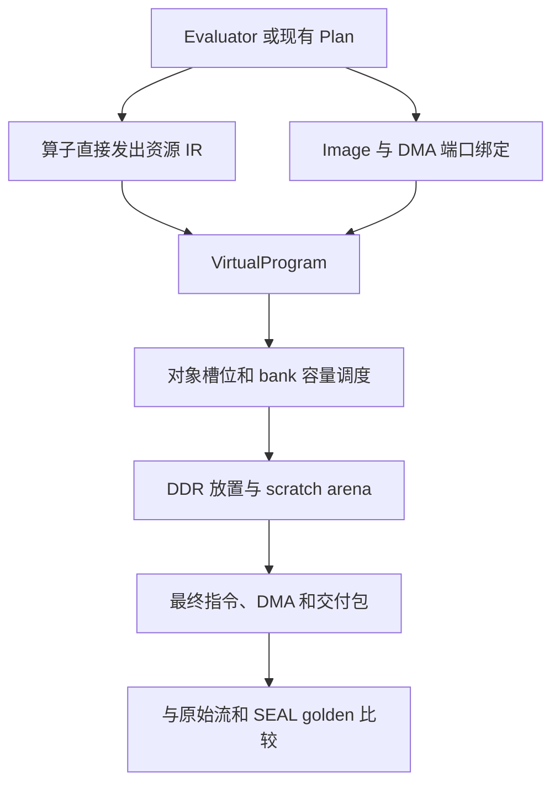

# 编译器资源管理

## 1. 当前实现位置

公共资源编译器位于 `hpu/compiler/resource_ir.hpp/.cpp`，算子资源接口位于
`hpu/compiler/operator_resources.hpp/.cpp`。CKKS、BFV、BGV 使用相同的对象调度、
DDR 生命周期复用和交付编译后端。

算子直接声明 `Operand` 角色并发出 typed `OperatorProgram`：`read` 声明数据输入端口，
`publish` 声明结果端口，`discard` 给出生命周期提示；算术和变换使用这些虚拟操作数。
算子中不选择物理 `p0..p7`。同一个角色的不同读入会形成不同的 `VirtualObject`，
最终对象编号、加载、释放、spill/reload 和可消除的内部写回由公共后端决定。



`Recording` 作用域收集嵌套算子发出的 typed 操作；它在线程间隔离，退出和异常展开
恢复外层作用域。CKKS/BFV lowering 携带原生资源程序；BGV 拼接原生子程序时同步
拼接资源 IR。原生路径不从汇编字符串或已编码对象字段恢复虚拟数据流。

现有 `generate_*_body_asm` 返回接口保留，资源接口同时渲染兼容汇编作为 NoOpt
基准。历史对象角色到物理编号的映射只存在于兼容渲染器。原始汇编和现有 DMA
recipe 继续用于端口绑定与对照验证；本次没有合并所有方案的数据准备 recipe。

Evaluator 在 `compile()` 时调用公共交付编译器。旧 Plan 创建的 application package
也携带原生资源程序，`write_application_package()` 在私有镜像上自动完成相同的
资源优化、重定位和严格逐指令对拍，不修改调用者的 Image/Plan。CKKS Plan 的 Relinearize/Rescale 默认声明独立系数工作区，
保留输入节点的 NTT 数据，这些工作区由后端按生命周期复用。已编译的前端包
不会再次调度。只含原始编码指令的历史请求保留原有导出方式。

命令行旧 Plan 示例打印的 `--print-asm` 和指令计数属于兼容基准；最终交付指令及
DMA 地址以包中的 `program/*.asm`、`*.inst32` 和 `resolved_dma.csv` 为准。

### 编写算子

```cpp
namespace r = hpu::resource;
// value/auxiliary/accumulator 是算法角色，不是物理寄存器编号。
code << r::read(r::value, hpu::DataType::poly);
code << r::read(r::auxiliary, hpu::DataType::poly);
code << r::multiply(r::accumulator, r::value, r::auxiliary);
code << r::discard(r::value) << r::discard(r::auxiliary);
code << r::publish(r::accumulator);
```

调用方提供每个数据端口的 allocation/span。`bind_program()` 验证端口范围、只读
属性、长度、定义与使用以及与兼容基准的操作一致性；`compile_resources()` 对直接
生成的 `VirtualProgram` 分配资源。旧 `optimize_resources()` 保留编码流导入入口，
用于历史流回放和回归对照。

## 2. 逻辑值、对象与缓冲区

三种概念分别承担不同职责：

| 概念 | 职责 |
| --- | --- |
| 前端逻辑值 | 数学依赖、level、分量数、scale、correction factor |
| `VirtualObject` | 一段片上对象生命周期及长度、加载类型 |
| `VirtualBuffer` | DDR 逻辑分配、读写属性、首次/最后使用及布局标签 |
| `VirtualInstruction` | 对象 uses/definitions、DDR range、原始指令及算子来源 |

一个逻辑密文含多个分量和 RNS limb，因此会对应多个对象与缓冲区。算子的符号操作数在每次定义时建立对象生命周期，调度器选择物理槽位。输入端口的 `BufferRange` 记录初始化来源。

内存布局与数学域分别处理。IR 提供 `coefficient_natural`、`coefficient_bit_reversed`、`canonical_ntt_physical`、`unspecified` 标签。`CompileOptions.buffer_layouts` 可按真实 allocation 名称显式标注，NoOpt 与优化模式均保留标签，不据此修改字值。

前端根据适配器标注已知输入与评估密钥，并按 golden ABI 标注输出；输出标签表示期望布局，数值是否满足仍由指令比较决定。新应用镜像的完整变换使用自然系数边界，但一个 workspace 在执行中仍可能保存系数、NTT 或 stage 中间数据，因此跨域 workspace 保持 `unspecified`，不根据名称推测排列。

## 3. NoOpt 基准

`OptimizationMode::no_opt` 保留：

- 每个原始指令字；
- 每条 DMA 的原始 offset/count；
- 原始镜像字节和分配。

同时检查对象、DMA 和 bank 容量，并生成资源统计。它用于重现原始调度，以及与优化版本比较。

NoOpt 只保证保留输入程序，原始程序与 oracle 的数学一致性仍由独立验证决定。

## 4. DDR 复用

为了提供逐节点读回，输入、常量、明文、评估密钥和每个计算节点结果都保留独立存储。因此当前优化重点是算子内部 `workspace`。

workspace 只有满足以下条件才可进入复用区：

1. 可写且不属于需要保留的结果。
2. 所有初始读操作之前，相关 line 已由程序写入。
3. 生命周期与拟复用的区域没有交叠。

依赖初始零值的 workspace 会保留独立存储。复用器按使用区间进行确定性、line 对齐的放置，并建立统一 `$compiler/scratch_arena`。

`memory/memory_manifest.csv` 描述真实物理分配；scratch arena 作为一个分配出现。每个逻辑 workspace 的子范围在 `oracle/report.json` 的 `compiler_resources.logical_buffers` 中记录。最终 DMA 指向实际物理分配与对应子 span，避免在物理分配清单中出现多个重叠 allocation。

spill 存储使用独立的可写 backing，保留输入和只读资源。优化的目标不包括覆盖仍需供 IT 读回的逐节点结果。

## 5. 片上对象调度

HPU 有 **8 个逻辑对象槽位**和 **5 个普通 bank**；两者分别管理。普通 bank 容量为 1024 line，每条 line 为 64 个 uint32，即 256B。N=65536 的单个 limb 占 1024 line。

当前采用保守方式：每个普通 resident object 占一个 bank。它不会把多个短对象挤入同一个 bank。模上下文表使用独立 small Bank 5，最大 32 line，并保留其自身对象槽位。

NTT/INTT 每个 stage 执行 out-of-place，调度时除了数据和 twiddle 的 resident bank，还计入一个额外输出 bank。固定的 128 个 NTT 运算寄存器由硬件 stage 调度使用，当前没有新增 PE 寄存器分配接口。

调度器根据后续使用安排保留、释放、spill 和 reload。需要腾出空间时，避开当前指令的操作数，并优先处理更晚才再次使用的对象；可重新加载的干净数据直接释放，脏数据保存到可写 backing。槽位分配和淘汰顺序保持确定性。

`DSTORE` 按当前 executable ABI 写回并释放源对象。以后再次使用它需要 DLOAD。只有证明内部 workspace 写回与唯一读取可被保留对象替代时，才延迟该写回；计算节点输出的必需写回继续保留。

最终编码仍使用现有 ISA，DMA 继续使用冻结的 `x10/x11` offset/count ABI。

## 6. 三条验证路径

前端自动执行：

```text
native SEAL 图执行
        ↕ 每个节点的元数据和字值
各方案 SoftwareExecutor
        ↕ 同一份 oracle golden
最终指令字 + 实际 DMA span 的 host 执行模型
```

SEAL oracle 不以 SoftwareExecutor 的计算结果作为输入。逐指令模型独立解码 `instruction.word`，不依赖 companion `normalized_asm` 或语义对象字段，并从实际镜像读取 modulus、常量及 twiddle。

逐指令执行与比较分为两个状态：

- `InstructionExecutionReport::completed()`：指令与 span 执行完成。
- `InstructionMemoryComparison::verified`：保留输出逐字等于 oracle。

执行完成不意味着与 oracle 一致。缺少 DMA、非法生命周期、只读区写入、bank 不足、未知 mode/flag、数值不匹配分别给出诊断。

优化模式还执行原始流并比较 NoOpt 与优化流的所有保留输出。这个比较检查调度和复用是否改变了原始指令模型结果；与 SEAL 的比较检查结果是否满足独立数学 oracle。两者单独记录。

## 7. 当前 NTT 验证边界

`execute_ntt_stage` 只执行供应表所指定的一个 raw loader/BF/P stage。逐指令层提供两个功能软件契约：

| `InstructionNttContract` | 行为 |
| --- | --- |
| `natural_coefficient_boundaries` | 默认；PNTT stage 0 的 raw stage 前做数学边界 BR，最后一个 PINTT raw stage 后做数学边界 BR，完整变换以自然位置读写系数 |
| `legacy_raw_stage` | 保留旧 loader/BF/P stage；不增加整体边界转换，正向入口使用 BR 系数 |

两个契约都逐位置执行 PMUL，原样消费 DMA 和表。默认契约中的两次 BR 是软件
数学边界转换，不是额外编码的 BR 指令，也不声称复现 RTL 每个 stage 的读写地址。
报告记录 `ntt_contract`、`forward_boundary_conversions`、
`inverse_boundary_conversions` 和 `hardware_contract_verified=false`。

三方案 builder 与 SoftwareExecutor 采用相同的自然系数 pre/post 索引；完整公式、
stage 表顺序及 raw inverse API 适配见 [编程手册的变换契约](../reference/HPU_PROGRAMMING_MANUAL.md#5-变换指令)。
数据 ABI 与旧包迁移见 [应用包 V1](../delivery/HPU_APPLICATION_PACKAGE_V1.md#新应用镜像的-ntt-表与软件边界)。
选择回放契约不修改镜像、DMA 或指令，新自然镜像使用 legacy profile 可能比较失败。

严格编译默认要求三条路径通过，发现差异即失败。`CompileOptions.require_instruction_verification=false` 是显式诊断模式，允许导出带失败记录的包；它仍要求 SEAL 与算子软件模型通过，并检查优化是否改变原始流结果。

`CompiledApplication::verified()` 表示 SEAL 与算子软件模型验证，`instruction_verified()` 单独表示最终 host 指令模型逐字匹配。RTL、上板和目标指令执行状态继续为 false，host 验证采用独立字段。

完整往返正确不能单独证明正向谱正确；验证应包含独立求值或 SEAL oracle，并检查
canonical 与 modified-root 路径。实际测试规模及结果以测试日志和各包报告为准。
独立反例、CKKS 舍入修复及验收快照见 [2026-10 审计](../audits/HPU_NTT_CONTRACT_AUDIT_2026-10.md)。

## 8. 资源报告

报告写入 `oracle/report.json` → `compiler_resources`，也可通过 `compiled.resource_report_json()` 读取。`ir_source="operator"` 表示来自算子直接发出的资源 IR；历史导入入口记录 `encoded_import`：

| 字段 | 内容 |
| --- | --- |
| `ir_source` | `operator` 或 `encoded_import` |
| `original_ddr_lines` / `allocated_ddr_lines` | 原始与最终 DDR 使用量 |
| `scratch_arena_lines` | 复用工作区的物理容量 |
| `original_dma_count` / `dma_count` | 优化前后 DMA 次数 |
| `peak_regular_banks` / `peak_object_slots` | 调度峰值，计入 stage 额外 bank |
| `deferred_scratch_stores` | 可通过片上保留延迟的内部写回 |
| `spills` / `reloads` | 资源压力下的保存与重载次数 |
| `logical_buffers` | 逻辑名称、物理 allocation、原始及最终 span、生命周期、布局标签 |

能节省多少 DDR 和 DMA 取决于图及 workspace 生命周期；保留所有节点结果会限制压缩空间。

API 使用与诊断命令见 [Evaluator 前端入门](../getting-started/HPU_EVALUATOR_FRONTEND.md)。现有包格式见 [应用包 V1](../delivery/HPU_APPLICATION_PACKAGE_V1.md)。
